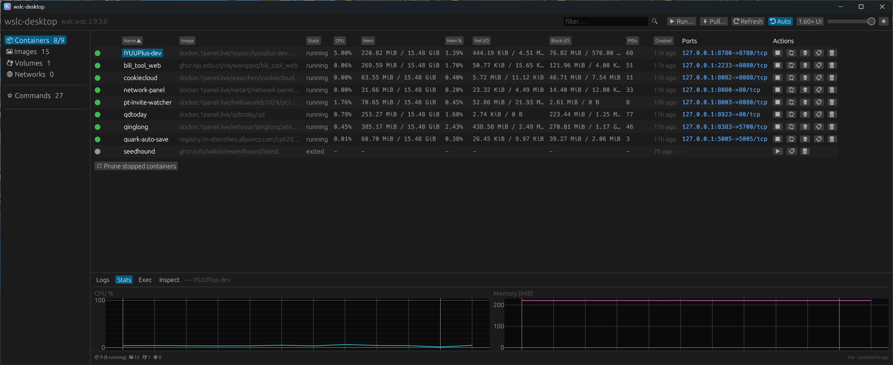

# wslc-desktop

> A native desktop GUI for managing **Microsoft WSL Containers** (`wslc.exe`) — written in pure Rust, shipped as a single self-contained executable with zero runtime dependencies.
>
> 📖 中文文档 / Chinese version: [README.zh-CN.md](README.zh-CN.md)

`wslc` is Microsoft's container solution, announced at Build 2026 and entering public preview on 2026-06-29. It uses Docker-compatible syntax and is built on Moby, but **Microsoft only ships a CLI — there is no GUI**. The community's `lazywslc` / `lazywslcontainer` are terminal TUIs. `wslc-desktop` fills that gap: it brings day-to-day container, image, and volume management into a responsive windowed app, with live CPU / memory charts.



---

## ✨ Features

| Area | Capabilities |
| --- | --- |
| **Containers** | List (incl. stopped, with **live CPU / memory / network I/O / block I/O / PIDs columns** and **click-to-sort headers**), start / stop / restart / kill, delete (forceable), bulk prune, one-click open ports in browser |
| **Images** | List, **per-image `In Use` status column (click to jump to the containers using it)**, **per-row one-click re-pull of that tag** (`🔄`, updates the image to the latest remote digest; disabled for dangling images), delete, prune, pull from registry (with timeout guard); the Pull dialog bundles **one-click China mirror sources** (1Panel / DaoCloud / 毫秒镜像 / Nanjing University / 轩辕镜像 / rat.dev / dockerpull) that rewrite the registry prefix automatically |
| **Volumes** | List, delete, create (guest / vhd driver), bulk prune |
| **Networks** | List, create, delete, bulk prune — neither TUI competitor has this |
| **Run wizard** | image / name / port mappings / env vars / volume mounts / network / workdir / user / hostname / memory / CPU count / entrypoint / command / detached / auto-remove / publish-all-ports; live `wslc run …` preview you can copy; **Save to Commands** checkbox also stores the command in the library (named after the container, same name overwrites) |
| **Detail panel** | Logs (**streaming follow `-f`**, timestamps, reload, copy-all), raw `inspect` JSON, CPU% / memory chart for the selected container, Exec (running containers only) |
| **Saved Commands** | Save & persist any `wslc run …` command line; one-click run / copy / edit (📝) / delete; **click-to-sort by Name / Description / Command**; seeds **27 homelab container presets** from `wslc-menu.ps1` on first launch; "Restore presets" tops up without overwriting your custom entries; **local preset override**: drop a `presets.local.json` (gitignored, never committed) next to the exe or in the working directory to override builtin presets by name — ideal for personal commands carrying real credentials |
| **Live monitoring** | Background 2s `wslc stats` poll, scrolling samples for trend charts; container list shows CPU / Mem / Mem% / Net I/O / Block I/O / PIDs directly. **Polling pauses while the window is hidden** (no wslc subprocesses in the tray), resumes with an immediate refresh when shown, and stays on during a login-autostart sequence |
| **Non-blocking actions** | Long-running calls (`pull` / `run` / lifecycle actions / `logs` / `inspect` / `exec` / create) run in a **serialized slow lane** off the polling thread — a 600 s image pull no longer freezes the 2 s refresh, and actions keep their one-at-a-time ordering |
| **Experience** | Dark / light theme toggle (persisted), **global UI-scale slider** (top bar `× UI`, 80%–250% live, scales layout + fonts together, defaults to 110%), filter by name / image / driver, danger-action confirmation, result toasts, bottom status bar (counts + live/paused + "updated Ns ago"), state color coding, **bundled CJK font** (Noto Sans SC subset so Chinese command descriptions render instead of tofu boxes), **all icons / symbols bundled** (window icon + action buttons + sort arrows ship with the font, so nothing boxes on any host) |
| **Autostart & tray** | **Start with Windows** via the per-user `HKCU\…\Run` key (no admin rights), **silent login start** (tray icon only, no window flash), notification-area icon (left-click shows the window; right-click menu: show / hide / quit), **close-to-tray** (the × button hides the window instead of quitting), **per-container autostart checkboxes** in the `Auto` column (checked containers are started when the app itself auto-starts at login), and **quit-after-autostart** (exit once every autostart container is running; 180 s give-up timeout) |

> State mapping (cross-checked against `lazywslc`/`lazywslcontainer` and verified on local wslc 2.9.3.0): `1=Created`, `2=Running`, `3=Exited`, `4=Paused`. wslc ≥3.x reports `State` as a string (`"exited"`) instead of a number; both encodings are accepted.
> **Known limits**: wslc currently offers no `pause`/`rename`, CVE/SBOM scanning, drag-and-drop volume mounts, or Compose — this tool does not fake those commands.

---

## 🏗️ Architecture

```
┌─────────────────────────────────────────────┐
│                UI layer (egui/eframe)         │
│  top_bar · sidebar · resource tables · detail · dialogs │
└───────────────▲───────────────┬──────────────┘
                │ WorkerEvent    │ UiRequest
        (mpsc channel, non-blocking)            │
┌───────────────┴───────────────▼──────────────┐
│        polling worker thread (poller.rs)       │
│  2s snapshot/stats poll (paused when hidden)  │
│  + control requests + log-stream pump         │
└───────────────────────┬──────────────────────┘
                        │ dispatches slow requests
┌───────────────────────▼──────────────────────┐
│  serialized slow lane (single-flight FIFO)     │
│  pull / run / actions / logs / inspect / exec │
└───────────────────────┬──────────────────────┘
                        │
┌───────────────────────▼──────────────────────┐
│      wslc backend (src/wslc/, GUI-agnostic)    │
│  client(std::process) · commands · types(serde)│
└───────────────────────┬──────────────────────┘
                        │  wslc.exe --format json
                        ▼
                  Microsoft WSL Containers
```

**Key design choices:**
- **The UI never blocks**: every `wslc` subprocess call runs on a background thread and talks to the UI over `std::sync::mpsc`; no tokio.
- **Two-lane scheduling**: the polling thread only does control work and the 2 s snapshot. Slow requests are queued in a single-flight lane, so a 600 s pull cannot stall the refresh, and actions stay strictly ordered.
- **An idle tray is truly idle**: while the window is hidden and no login-autostart sequence is running, no wslc subprocess is spawned. `update()` still requests a repaint every 500 ms, so tray clicks stay responsive; showing the window refreshes immediately.
- **No console flash**: each subprocess is spawned with `CREATE_NO_WINDOW` (`0x08000000`) on Windows.
- **Bounded timeouts**: every command has a timeout (default 20s); on timeout it is killed and an error returned, so the UI can't hang.
- **Reusable backend**: `src/wslc/` has zero dependency on egui and can be reused by a TUI / CLI / tests.

---

## 🧰 Tech stack

| Component | Choice | Notes |
| --- | --- | --- |
| GUI framework | **egui / eframe 0.29** | Immediate mode; ideal for live tables & charts; produces a single self-contained `.exe`, no WebView2 / Node |
| Plotting | egui_plot 0.29 | CPU / memory trend charts |
| Serialization | serde / serde_json | Parse `wslc --format json` |
| Error handling | anyhow | |
| Time | chrono | Relative-time display |

> Why not Tauri: Tauri needs the WebView2 runtime + a front-end toolchain, making a heavier artifact with more dependencies. Since the user prefers "self-contained, no external deps", egui was chosen. Tauri remains a candidate for heavier future UI needs.

---

## 📦 Requirements

- **Windows** with a working `wslc.exe` (validated against **wslc 2.9.3.0** and **3.0.1.0**; both JSON generations — array + numeric fields vs NDJSON + string fields — are parsed transparently)
- Building needs **Rust** (stable, `edition 2021`; developed on rustc 1.95 / cargo 1.96)

Verify wslc is available:

```powershell
wslc version
wslc list --all --format json
```

---

## 🚀 Build & run

```bash
# Run in development
cargo run

# Release build (strip + thin-LTO, minimal single file)
cargo build --release
# Output: target/release/wslc-desktop.exe
```

> **Launch flags** (what the login Run-key entry passes; also usable manually):
> `--autostart` — start the autostart-checked containers on launch (and honour
> "quit when they are up"); `--silent` — start hidden, tray icon only.
> Both are optional; running the exe with no flags is the normal interactive mode.

> **Domestic network note**: the official crates.io CDN can be very slow on some networks. The repo ships a `.cargo/config.toml` that points crates.io at the **rsproxy.cn** mirror (sparse index + crate download). Delete that file if your environment can reach the official source directly.
>
> **Release builds (CI)**: pushing a `v*` tag triggers `.github/workflows/release.yml`, which compiles on `windows-latest` using upstream crates.io and publishes `wslc-desktop.exe` as a Release asset.

---

## 🗂️ Project layout

```
wslc-desktop/
├── Cargo.toml
├── build.rs                    # Embed Windows exe icon (winresource)
├── .cargo/config.toml          # rsproxy mirror + network resilience
├── .github/workflows/release.yml  # tag-triggered: build & publish Release asset
├── assets/                     # app icon + bundled font
│   ├── icon.ico                #   exe icon (winresource-embedded)
│   ├── icon_rgba.bin           #   runtime window icon (loaded by eframe, no decode dep)
│   ├── screenshot.png          #   app showcase image used in this README
│   ├── fonts/NotoSansSC-Subset.otf  # CJK font subset (GB2312, ~1.8 MB)
│   ├── make_icon.py            #   icon generation script (Pillow)
│   └── make_font.py            #   font subsetting script (fontTools)
├── docs/
│   └── 竞品拆解与技术方案.md      # competitor teardown + architecture/tech-choice design doc (zh)
├── src/
│   ├── main.rs                 # eframe entry point + launch-flag parsing
│   ├── app.rs                  # app state, event loop, top-level layout
│   ├── autostart.rs            # HKCU Run-key login entry + --autostart/--silent flags
│   ├── tray.rs                 # notification-area icon + context menu
│   ├── poller.rs               # polling worker + serialized slow lane + hidden-window throttling
│   ├── wslc/                   # GUI-agnostic wslc backend
│   │   ├── client.rs           #   subprocess exec, timeout, header stripping
│   │   ├── commands.rs         #   wslc command wrappers
│   │   ├── types.rs            #   serde data models + state enum + unit conversion
│   │   └── mod.rs
│   └── ui/                     # egui rendering (all WslcDesktopApp impls)
│       ├── layout.rs           #   top bar / sidebar / resource tables / saved commands
│       ├── detail.rs           #   logs / stats / inspect detail panel
│       └── dialogs.rs          #   confirm / run / command-edit dialogs / Toast
└── wslc-menu.ps1               # saved-commands preset source: the original PowerShell menu script
```

---

## 🆚 Competitors

| Project | Language | Form | GUI | Live monitoring |
| --- | --- | --- | --- | --- |
| **wslc-desktop** | Rust | Native window | ✅ | ✅ CPU/memory charts |
| lazywslc | Rust | Terminal TUI | ❌ | Partial |
| lazywslcontainer | Go (bubbletea) | Terminal TUI | ❌ | Partial |
| Docker Desktop | Multi | Electron | ✅ | ✅ (but not for wslc) |

See [`docs/竞品拆解与技术方案.md`](docs/竞品拆解与技术方案.md) for the full teardown.

---

## ✅ Milestones

- **M1 (2026-07-15)**:
  - CRUD for containers / images / volumes / networks.
  - Lifecycle ops: start / stop / restart (emulated as stop+start) / kill / remove (forceable).
  - Run wizard: image / name / ports / env / volumes / network / workdir / user / hostname / memory / CPU / entrypoint / command, with a live `wslc run …` preview.
  - Live stats charts: background 2s `wslc stats` poll, scrolling CPU / memory trend samples.
  - Streaming logs (follow `-f`, timestamps, copy-all) + raw `inspect` JSON.
  - Exec into running containers.
  - Dark theme (persisted).
  - One-click open container ports in the browser.
  - **Saved Commands**: 27 homelab presets + persistence + one-click run / copy / edit / delete.
  - Warning-free build (`cargo clippy --all-targets` clean).
- **M2 (2026-07-16)**:
  - Image `In Use` status column (registry / namespace-tolerant match; click to jump to containers using the image).
  - One-click China mirror sources in the Pull dialog.
  - Chinese command descriptions render correctly (bundled Noto Sans SC subset, no tofu).
  - **Click-to-sort headers** on the container table and the Saved Commands table (click again to toggle asc/desc).
  - Window icon + action buttons + sort arrows all bundled with the font, so nothing boxes on any host.
  - Top-bar `× UI` slider for **global UI scaling** (80%–250%, defaults to 110%), scaling layout + fonts together and persisting.
- **M3 (2026-11-14)**:
  - **Start with Windows** via the per-user Run key (no admin rights), with a **silent login mode** that boots straight to the tray — no window flash.
  - Notification-area icon: left-click shows the window; right-click menu with show / hide / quit.
  - **Close-to-tray**: the × button hides the window (background polling pauses until the window is shown again); quit via the tray menu.
  - **Per-container autostart checkboxes** (`Auto` column): checked containers are started when the app itself is auto-started at login.
  - **Quit-after-autostart** option: the app exits on its own once every autostart container is running (180 s give-up timeout).
- **M4 (2026-11-16)**:
  - **Two-lane worker**: long-running wslc calls moved to a serialized slow lane, so a 600 s `pull` no longer freezes the 2 s snapshot refresh.
  - **Idle tray polling**: no wslc subprocesses while the window is hidden; immediate refresh when shown; polling stays active during the login-autostart sequence.

---

## 🛣️ Roadmap

- Log regex search / highlight (front-end text match; wslc has no stream filter).
- Saved-Commands grouping / tags / import-export (currently a flat list).
- MSI packaging (cargo-wix, see lazywslc `wix/`).
- i18n (Chinese / English UI).
- Auto-update check (compare against the GitHub Release).
- Deeper visual editing of ports / volumes / networks.

---

## 📄 License

MIT
